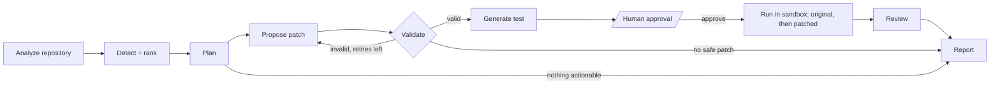

# DevPilot AI

An agentic software-engineering assistant. Give it a public GitHub repository and it finds candidate bugs,
proposes **one** reviewable patch, writes a test, and — only after you approve — runs that test on the original
and the patched code inside a locked-down Docker container. The report says exactly what was and was not verified.

**Stack:** FastAPI · LangGraph · Ruff + Bandit + Python AST · any OpenAI-compatible LLM (Groq by default) ·
SQLAlchemy (SQLite or PostgreSQL) · React + Vite · Docker sandbox · scikit-learn experiments.

## How it works



| Step | Who does it | Notes |
| --- | --- | --- |
| Analyze | Deterministic | AST checks, Ruff, Bandit. Nothing is cloned or executed. |
| Rank | Heuristic score, optional ML model, optional LLM annotation | The LLM can only annotate existing findings, never invent new ones. |
| Patch | Rule-based fixers first, LLM otherwise | The LLM returns `old_snippet`/`new_snippet`; **the backend builds the diff**. |
| Validate | Deterministic | Known path, no traversal, size limit, snippet unique, patched file parses. Bounded retries. |
| Test | Template (rule fixes), LLM (screened), or syntax check | Test strength is shown in the UI. |
| Approve | **You** | Required before anything runs. Nothing is ever pushed to GitHub. |
| Verify | Docker sandbox | "Verified" means: fails on original **and** passes on patched. Anything else is labelled weaker. |

## Run it (Windows, macOS, Linux)

Prerequisites: Python 3.11+, Node 18+, Docker Desktop (only for the sandbox).

```bash
# 1. Backend
cd backend
python -m venv .venv
.venv\Scripts\activate          # macOS/Linux: source .venv/bin/activate
pip install -r requirements.txt
copy .env.example .env          # macOS/Linux: cp .env.example .env   (add LLM_API_KEY / GITHUB_TOKEN if you have them)
uvicorn app.main:app --reload --port 8000

# 2. Frontend (new terminal)
cd frontend
npm install
npm run dev                     # http://localhost:5173

# 3. Sandbox image (needed to run tests; analysis and patches work without it)
docker build -t devpilot-sandbox -f sandbox/Dockerfile sandbox/
```

The header of the UI shows whether the API, the model and the sandbox are available.
Without `LLM_API_KEY` DevPilot still works: it uses static analysis and rule-based fixes (bare `except:` and `== None`).
Set `GITHUB_TOKEN` (any token with no scopes) to avoid GitHub's 60-requests/hour anonymous limit.

## Verify the project yourself

```bash
cd backend && python -m pytest                     # 52 tests: analyzers, patch validator, workflow, API, sandbox command
python ../benchmarks/run_benchmark.py              # recall / false positives on fixtures with known bugs
cd ../ml && pip install -r requirements.txt
python train_severity.py && python evaluate.py     # ML experiments (see ml/datasets/README.md first!)
```

## API

| Method | Endpoint | Purpose |
| --- | --- | --- |
| GET | `/api/health` | API, model and sandbox status |
| POST | `/api/repositories/inspect` | Validate a repo and list eligible files |
| POST | `/api/analysis` | Start a task (returns `task_id`) |
| GET | `/api/tasks`, `/api/tasks/{id}` | History; status and agent events |
| GET | `/api/tasks/{id}/findings` | Findings |
| GET | `/api/tasks/{id}/patch` | Diff, test code, test results |
| POST | `/api/tasks/{id}/approve` | `{approved: true/false, note}` — starts sandbox testing |
| GET | `/api/tasks/{id}/report` | Final report (404 until approved/rejected or no patch) |

Interactive docs: http://127.0.0.1:8000/docs

## Security model

- **Untrusted input.** Repository text and generated code are data. Prompts wrap code in delimiters and instruct the model to ignore embedded instructions (this reduces, not eliminates, prompt-injection risk, which is why the model can't apply anything itself).
- **Secrets.** Credential-like strings are redacted before any LLM call and from stored evidence.
- **No repo execution outside Docker.** Containers run with no network, read-only root, all capabilities dropped, `no-new-privileges`, non-root user, 512 MB, 1 CPU, 100 processes, a timeout, and a read-only bind mount of a throwaway workspace.
- **Patch validation.** The model never supplies a diff to execute; paths must belong to the fetched file set.
- **Approval gate.** The sandbox only runs after an explicit approval; nothing is pushed to GitHub.
- **Access control.** Set `DEVPILOT_API_KEY` to require a bearer token; tasks are scoped per key. In-memory rate limiting is included (use Redis for multi-worker deployments).

## Limitations (read before you trust a result)

- Python only; ≤ 60 files / 100 KB each / 1 MB total by default; public repositories only.
- Static findings are candidates. Lint rules flag *potential* defects.
- The sandbox has no network, so tests needing third-party packages can't run; those show as `error`, not `failed`.
- Rule-based tests prove the flagged *pattern* was removed, not that behaviour is correct. LLM-written tests are only evidence if they fail before and pass after, and you should read them.
- Verified in development: unit/integration tests with mocked GitHub and sandbox, a live API run, the benchmark, and the frontend build. **Not** exercised by the automated tests: calls to a real LLM provider and an actual Docker run. Try those on your machine and read `docs/evaluation.md`.
- The severity model and duplicate detector ship with tiny synthetic data for smoke-testing only. No accuracy claims are made.

## Layout

```
backend/   FastAPI app (api/, agents/, tools/, services/, schemas/) + tests/
frontend/  React + Vite dashboard
sandbox/   Dockerfile for the test-runner image
ml/        severity classifier + duplicate retrieval experiments
benchmarks/ fixtures with known bugs and a runner
docs/      architecture.md, evaluation.md
```
